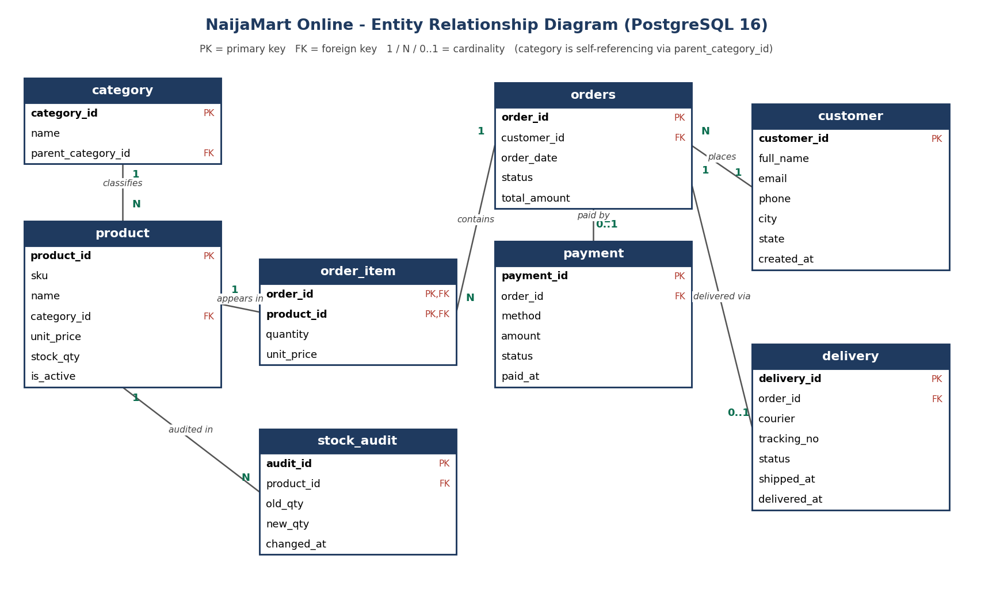

# Portfolio 1 - Database Design and Modelling

## 1. Selected case study

| Item | Description |
|---|---|
| **Organisation / scenario** | **NaijaMart Online** - a *simulated* Nigerian e-commerce platform |
| **Nature of the business** | Online retailer selling electronics, fashion, home goods, groceries, beauty and stationery to customers across Nigerian states, delivered by third-party couriers |
| **Users of the database** | Customers (place orders), warehouse staff (update stock), finance team (reconcile payments), logistics team (track deliveries), management (sales reports) |
| **Major data stored** | Categories, products and stock levels, customers, orders and order lines, payments, deliveries, stock audit log |
| **Key operations** | Add products, place an order, deduct stock, take payment, ship/deliver, cancel/refund, sales and customer reports, stock auditing |

The same case study is used in all five portfolio activities.

**Data volume (synthetic, generated by `02_seed_data.sql`):** 12 categories, 300 products, 20,000 customers, 200,000 orders, 500,000 order lines, 174,379 payments, 164,295 deliveries.

## 2. ER diagram



| Relationship | Cardinality | Implemented by |
|---|---|---|
| category - product | 1 : N | `product.category_id` FK |
| category - category | 1 : N (self) | `category.parent_category_id` FK |
| customer - orders | 1 : N | `orders.customer_id` FK |
| orders - product | M : N | resolved by associative table `order_item` |
| orders - payment | 1 : 0..1 | `payment.order_id` FK + UNIQUE |
| orders - delivery | 1 : 0..1 | `delivery.order_id` FK + UNIQUE |
| product - stock_audit | 1 : N | `stock_audit.product_id` FK |

## 3. Relational schema (keys)

```
category   (category_id PK, name UNIQUE, parent_category_id FK->category)
customer   (customer_id PK, full_name, email UNIQUE, phone, city, state, created_at)
product    (product_id PK, sku UNIQUE, name, category_id FK->category, unit_price, stock_qty, is_active)
orders     (order_id PK, customer_id FK->customer, order_date, status, total_amount)
order_item (order_id PK,FK->orders, product_id PK,FK->product, quantity, unit_price)
payment    (payment_id PK, order_id FK->orders UNIQUE, method, amount, status, paid_at)
delivery   (delivery_id PK, order_id FK->orders UNIQUE, courier, tracking_no UNIQUE, status, shipped_at, delivered_at)
stock_audit(audit_id PK, product_id FK->product, old_qty, new_qty, changed_at, changed_by)
```

Full DDL: [`01_schema.sql`](01_schema.sql).

## 4. Constraints used

| Type | Examples |
|---|---|
| PRIMARY KEY | single (`customer_id`) and composite (`order_item(order_id, product_id)` - stops the same product appearing twice in one order) |
| FOREIGN KEY | every relationship above; `ON DELETE CASCADE` for order children (order_item, payment, delivery) so no orphans remain |
| UNIQUE | `customer.email`, `product.sku`, `delivery.tracking_no`, one payment/delivery per order |
| CHECK | `stock_qty >= 0`, `unit_price >= 0`, `quantity > 0`, valid `status` lists, `delivered_at >= shipped_at`, e-mail format |
| NOT NULL / DEFAULT | mandatory columns; `status DEFAULT 'PENDING'`, `order_date DEFAULT now()` |
| TRIGGER | `trg_audit_stock` writes to `stock_audit` whenever `product.stock_qty` changes |
| VIEW | `v_order_summary` for reporting |

**Evidence that the constraints work:** [`03_constraint_tests.sql`](03_constraint_tests.sql) deliberately breaks each rule; the database rejects every attempt - see [`evidence/03_constraint_tests_output.txt`](evidence/03_constraint_tests_output.txt).

## 5. Normalisation explanation

Starting point - a single spreadsheet-style table used by the business:

`ORDER_SHEET(order_id, order_date, customer_name, customer_email, customer_city, customer_state, product_sku1, product_name1, price1, qty1, product_sku2, ..., category_name, parent_category, payment_method, payment_amount, courier, tracking_no, delivery_status)`

| Step | Problem found | Fix |
|---|---|---|
| **1NF** - atomic values, no repeating groups | Repeating columns `product_sku1/qty1, product_sku2/qty2...` | Move each product line into its own row: `order_item(order_id, product_id, quantity)` |
| **2NF** - no partial dependency on part of a composite key | In `order_item(order_id, product_id)`, product name/category depend only on `product_id`; order date/customer depend only on `order_id` | Split into `product` and `orders` tables |
| **3NF** - no transitive dependency | `customer_city/state` depend on the customer, not the order; `category_name` depends on `category_id`, not `product_id`; payment and delivery attributes depend on their own keys | Separate `customer`, `category`, `payment`, `delivery` tables |

Result: every non-key attribute depends on *the key, the whole key and nothing but the key* (3NF). Data is stored once, so updating a customer's phone or a product's name is a single-row change and cannot become inconsistent.

**Deliberate, documented denormalisation (design trade-offs):**

1. `order_item.unit_price` copies the product price at the time of purchase. A later price change must **not** rewrite historic orders - this is a *price snapshot*, not redundancy by accident.
2. `orders.total_amount` stores the sum of the order lines so that reports and payment checks do not need to re-aggregate 500,000 rows each time. It is populated when the order is created and is verified in Portfolio 3 (transactions keep it consistent).

## 6. How to run

```bash
# PostgreSQL 16 in Docker (port 5433), password used only for local testing
docker run -d --name nm-primary -e POSTGRES_PASSWORD=portfolio_test -e POSTGRES_DB=naijamart -p 5433:5432 postgres:16.0
docker exec -i nm-primary psql -U postgres -d naijamart < 01_schema.sql
docker exec -i nm-primary psql -U postgres -d naijamart < 02_seed_data.sql
docker exec -i nm-primary psql -U postgres -d naijamart < 03_constraint_tests.sql
```

## 7. Files

| File | Purpose |
|---|---|
| `01_schema.sql` | Tables, keys, constraints, trigger, view |
| `02_seed_data.sql` | Reproducible synthetic data (`setseed`) |
| `03_constraint_tests.sql` | Negative tests proving constraints |
| `er_diagram.png`, `make_er_diagram.py` | ER diagram and the script that draws it |
| `evidence/` | Real output captured when the scripts were run |
