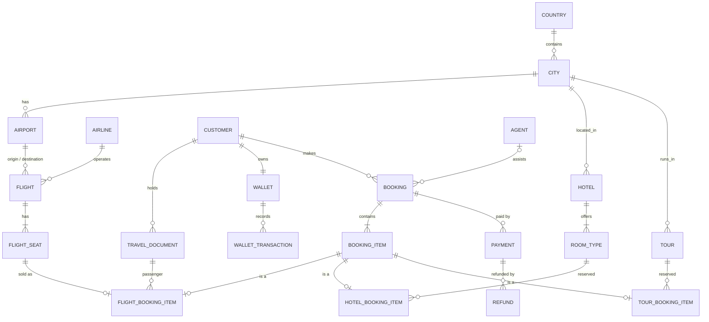

# Portfolio 1 — Database Design and Modelling

**Case study:** TripNest Travel & Booking Platform (see [`../docs/case-study.md`](../docs/case-study.md))
**DBMS:** PostgreSQL 16

## Contents

| File | Purpose |
|---|---|
| `sql/01_schema.sql` | Full relational schema: 21 tables, keys and constraints |
| `sql/02_seed_reference.sql` | Hand-written reference data (countries, cities, airports, airlines, agents) |
| `sql/03_seed_bulk.sql` | Reproducible generator for ~1.8M rows of simulated data |
| `sql/04_constraint_tests.sql` | Deliberately invalid statements that prove each constraint works |
| `diagrams/tripnest-erd.mmd` | ER diagram (Mermaid source, rendered below) |
| `evidence/` | Test output and row counts |

## How to run

```bash
createdb tripnest
psql -d tripnest -f sql/01_schema.sql
psql -d tripnest -f sql/02_seed_reference.sql
psql -d tripnest -f sql/03_seed_bulk.sql        # ~30-60 seconds
psql -d tripnest -f sql/04_constraint_tests.sql # every test should print an ERROR
```

## ER diagram



The full diagram, including attributes, is in `diagrams/tripnest-erd.mmd`. GitHub renders it automatically. For a PNG to use in the LMS document, paste the file into <https://mermaid.live> and export it.

## Key design decisions

**1. Supertype/subtype for booking items.**
A booking can contain flights, hotel stays and tours, and each kind has different attributes. Instead of one wide table full of NULLs, `booking_item` holds the shared columns (booking, type, amount). The subtype tables `flight_booking_item`, `hotel_booking_item` and `tour_booking_item` hold the specific columns and share the same primary key. This is class-table inheritance.

**2. A seat can only be sold once, enforced by the database.**
`flight_booking_item.seat_id` is `UNIQUE`. Even if application code has a bug, PostgreSQL will reject a second sale of the same seat. Portfolio 3 builds on this.

**3. Price is stored on the booking item.**
`booking_item.amount` copies the price at the moment of sale. This is not redundancy. Seat and room prices change over time, but a booking must keep the price the customer actually paid.

**4. Surrogate keys, with natural keys kept unique.**
Big tables use `BIGSERIAL` surrogate keys, which keep joins and indexes small. Natural identifiers still carry `UNIQUE` constraints: email, booking reference, seat number within a flight, and document number within type and country. Small, stable reference tables use their natural codes as primary keys (ISO country code, IATA airport and airline codes) because those codes never change.

**5. Version columns for concurrency.**
`flight_seat.version` and `wallet.version` support optimistic locking, which is demonstrated in Portfolio 3.

## Constraints summary

| Type | Examples |
|---|---|
| Primary keys | Every table |
| Foreign keys | 25+, e.g. `flight.origin_iata → airport`, `booking.customer_id → customer` |
| Unique | `customer.email`, `booking.booking_ref`, `(flight_id, seat_number)`, `flight_booking_item.seat_id` |
| Check (domain) | `status IN (...)`, `price > 0`, `star_rating BETWEEN 1 AND 5`, `balance >= 0` |
| Check (multi-column) | `arrival_time > departure_time`, `origin_iata <> destination_iata`, `check_out > check_in` |
| Referential actions | `ON DELETE CASCADE` on dependent rows (seats, room types, booking items, subtypes); restrict elsewhere so bookings and payments cannot be lost by accident |

All of these are tested in `sql/04_constraint_tests.sql`. The output is in `evidence/constraint-tests-output.txt`.

## Normalisation

**Starting point (unnormalised).** Think of a single booking record as an agent would write it on paper:

> Booking TN0001A3 · Customer Ada Adeyemi, ada@mail.test, passport A00000001 (NG) · Flights: [TN123 LOS→DXB 12 Dec seat 4B ₦120,000; TN124 DXB→LOS 19 Dec seat 7A ₦118,000] · Hotel: [Hotel 12, Dubai, Deluxe, 12–16 Dec ₦100,000] · Payment: card ₦338,000

**1NF.** The flights and hotels are repeating groups. Each one becomes its own row (`booking_item`) with a single atomic value in every column.

**2NF.** In a combined table keyed on (booking, flight, seat), attributes such as flight departure time depend on the flight alone, not the whole key. These partial dependencies are removed by splitting out `flight` and `flight_seat`. Likewise, hotel name and star rating depend only on the hotel, so they move to `hotel` and `room_type`.

**3NF.** Transitive dependencies are removed:
- `booking → customer_id → email`: customer details live only in `customer`.
- `airport → city → country`: an airport stores only `city_id`, and the country is reached through `city`.
- `flight_seat → flight → airline_name`: airline details live only in `airline`.

**BCNF.** In every table, every determinant is a candidate key. For example, in `flight_seat` the determinants are `seat_id` and `(flight_id, seat_number)`, and both are keys.

**Controlled redundancy (a deliberate exception).** `flight_seat.is_available` can be derived: it is false exactly when a `flight_booking_item` row exists for that seat. It is kept because:
1. Availability searches are the most frequent query in the system, and reading a flag avoids an anti-join on every search.
2. It gives Portfolio 3 a single row to lock when two customers race for the same seat.

Consistency is maintained by updating the flag in the same transaction that inserts the booking item. The integrity check at the end of `04_constraint_tests.sql` verifies that no sold seat is still marked available.

## Data volume

| Table | Rows |
|---|---|
| flight_seat | 600,000 |
| booking_item | ~330,000 |
| booking | 200,000 |
| payment | ~184,000 |
| customer / travel_document / wallet | 50,000 each |
| flight | 20,000 |

The generator uses `setseed(0.42)`, so it produces similar data on every run. Change the numbers in `CALL seed_bulk(...)` to scale up or down.
