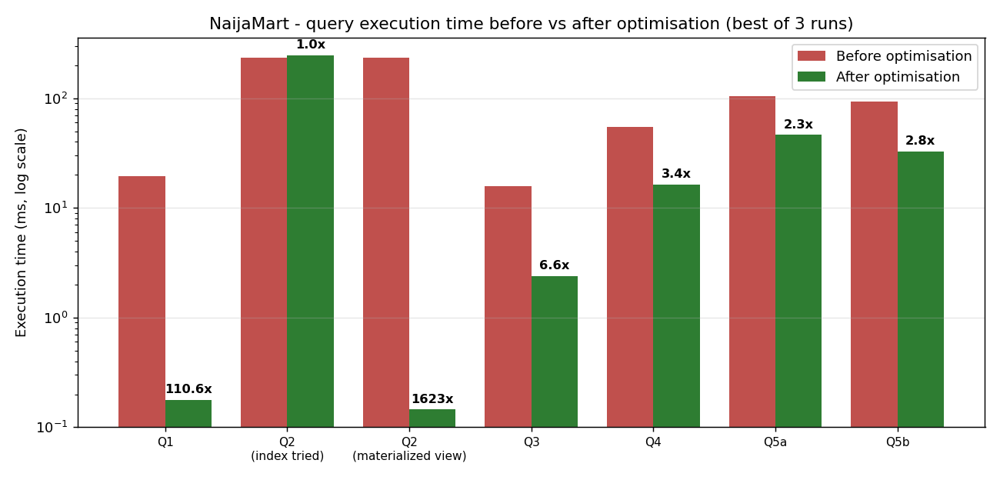

# Portfolio 2 - Query Processing and Optimisation

Case study: **NaijaMart Online** (see Portfolio 1). Data set: 200,000 orders, 500,000 order lines, 20,000 customers. DBMS: PostgreSQL 16 (Docker).

## What was done

1. Wrote 7 business queries covering joins, aggregation, sub-queries, `NOT IN` / `NOT EXISTS`, and a window function (`01_queries.sql`; real results in `evidence/01_query_results.txt`).
2. Captured **execution plans** with `EXPLAIN (ANALYZE, BUFFERS)` *before* any extra index (`evidence/02_explain_BEFORE_indexes.txt`).
3. Created targeted indexes (`03_create_indexes.sql`) and captured the plans *again* (`evidence/04_explain_AFTER_indexes.txt`).
4. Fixed the one query indexes could not help with a **materialized view** (`05_materialized_view.sql`).
5. Each timing is the **best of 3 runs** after a warm-up run, so cache effects are the same before and after (`evidence/timing_summary.csv`).

## Results

| Query | What it does | Before (ms) | After (ms) | Speed-up | Technique |
|---|---|---|---|---|---|
| Q1 | Order history of one customer | 19.6 | 0.18 | **111x** | Composite index `(customer_id, order_date DESC)` |
| Q2 | Top 5 products by revenue (reads all lines) | 235.4 | 247.6 | none | Index tried and **ignored by planner** |
| Q2 | same | 235.4 | 0.15 | **1623x** | Materialized view `mv_product_revenue` |
| Q3 | Stale PENDING orders | 15.9 | 2.4 | 6.6x | **Partial** index `WHERE status='PENDING'` (232 kB) |
| Q4 | Revenue by state, last 30 days | 55.0 | 16.4 | 3.4x | **Covering** index `(order_date) INCLUDE (...)` -> Index Only Scan |
| Q5a | Inactive customers - `NOT IN` | 104.6 | 46.4 | 2.3x | same covering index |
| Q5b | Inactive customers - `NOT EXISTS` | 93.5 | 32.9 | 2.8x | same covering index |



## Performance analysis (what the plans show)

* **Q1 - Seq Scan -> Index Scan.** Before: `Parallel Seq Scan on orders`, filter removed ~66,663 rows per worker, to find 5 rows. After: `Index Scan using idx_orders_customer_date`, 5 rows read directly and already in sorted order, so the `Sort` node disappeared. Equality column first, sort column second is what makes this index serve both the `WHERE` and the `ORDER BY`.
* **Q2 - an index is not always the answer.** The query aggregates *every* order line (100 % of the table). I created an index on `order_item(product_id)` and the planner still chose a sequential scan - correctly, because reading the whole table sequentially is cheaper than 500,000 random index lookups. I therefore removed that useless index (indexes slow down inserts/updates and use disk) and pre-computed the answer in a materialized view. Trade-off: data is only as fresh as the last `REFRESH MATERIALIZED VIEW CONCURRENTLY`.
* **Q3 - partial index.** Only 5 % of orders are PENDING, so the index contains only those rows: 232 kB instead of ~9.7 MB for a full index, and the plan becomes an `Index Only Scan`.
* **Q4 / Q5 - covering index.** `INCLUDE (customer_id, total_amount, status)` lets PostgreSQL answer entirely from the index (`Index Only Scan`), without visiting the table heap.
* **Q5a vs Q5b (query rewrite).** `NOT IN` and `NOT EXISTS` return the same 1,749 customers. `NOT EXISTS` was consistently as fast or faster here (and is the safer form: `NOT IN` returns *no rows at all* if the sub-query ever produces a NULL).
* **Cost of indexes.** The three indexes add ~16 MB and a small cost to every INSERT/UPDATE on `orders`. That is acceptable for a read-heavy shop front, and each index is justified by one measured query.

## Files

| File | Purpose |
|---|---|
| `01_queries.sql` | The business queries and results |
| `02_explain.sql` | `EXPLAIN ANALYZE` for each query (run before and after) |
| `03_create_indexes.sql` | Index definitions |
| `05_materialized_view.sql` | Pre-aggregation for Q2 |
| `make_chart.py`, `performance_chart.png` | Chart of the timing table |
| `evidence/` | Raw outputs: query results, plans before/after, index sizes, timing CSV |

## Reproduce

```bash
docker exec -i nm-primary psql -U postgres -d naijamart < 02_explain.sql   # BEFORE (drop idx_* first)
docker exec -i nm-primary psql -U postgres -d naijamart < 03_create_indexes.sql
docker exec -i nm-primary psql -U postgres -d naijamart < 02_explain.sql   # AFTER
docker exec -i nm-primary psql -U postgres -d naijamart < 05_materialized_view.sql
```
